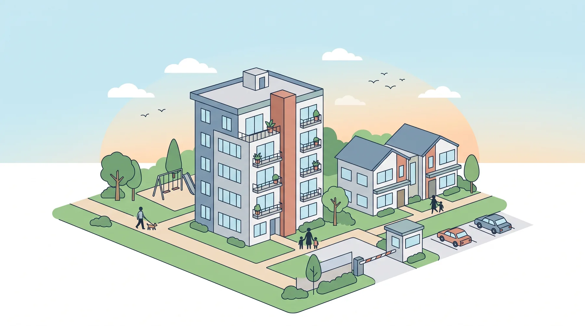
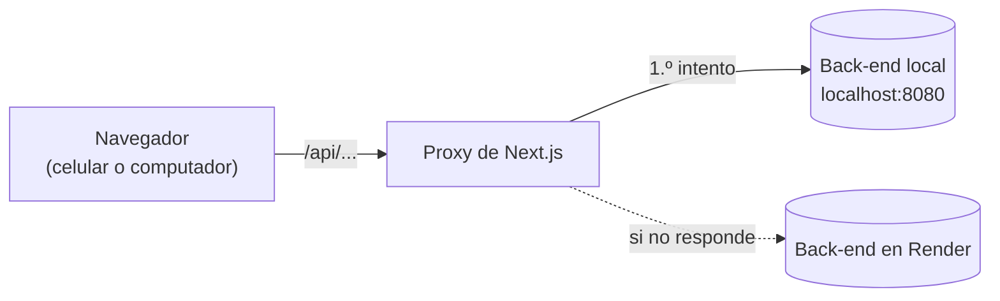

<div align="center">



# Torres del Parque
### Front end · Gestión residencial

Administra tu conjunto desde el computador o desde el celular.


</div>

Aplicación web para administrar un conjunto residencial (propiedad horizontal). Este repositorio es **solo el front
end**: los datos vienen de la API del back-end (repositorio aparte) y su contrato está en
[`ENDPOINTS.md`](ENDPOINTS.md). Hay tres tipos de usuario (administrador, vigilante y persona vinculada) y cada uno ve
solo sus pantallas.

## ✨ Qué puedes hacer

- 🏢 **Inmuebles, personas y vínculos:** quién vive en cada apartamento.
- 🚗 **Vehículos y parqueaderos,** con consulta por placa para el vigilante.
- 📦 **Correspondencia:** registro, entrega y quién la recibió.
- 📝 **PQRS:** peticiones, quejas, reclamos y sugerencias, con respuesta del administrador.
- 📅 **Zonas comunes y reservas,** con aprobación del administrador cuando la zona lo pide.
- 🔧 **Mantenimientos** programados, que bloquean la zona mientras duran.
- 🛂 **Control de visitantes:** preregistros, ingreso, salida e historial.
- 🔔 **Notificaciones** para las personas vinculadas.

## ⚡ Resumen rápido

| Qué | Dónde |
|---|---|
| 🌐 Front end | <http://localhost:3000> |
| 🔌 Back-end | <http://localhost:8080> (si no está, usa el de Render) |
| 🟢 Node.js | 20.9 o superior (se probó con 24) |
| 📦 Gestor | pnpm |

## 🧰 Tecnologías

- Next.js 16 (App Router, Turbopack), React 19 y TypeScript
- Estilos propios en `app/globals.css` (Tailwind 4 está instalado, pero casi no se usa)
- lucide-react para los íconos
- pnpm como gestor de paquetes

## 🚀 Cómo correrlo

```bash
pnpm install
pnpm dev
```

Abre <http://localhost:3000>. Lo ideal es tener el back-end encendido en `http://localhost:8080`; si no está, la app
prueba con el de Render (ver la sección siguiente para cambiarlo).

| Comando | Para qué |
|---|---|
| `pnpm dev` | Servidor de desarrollo (recarga solo al guardar) |
| `pnpm build` | Compila para producción |
| `pnpm start` | Sirve lo compilado con `pnpm build` |
| `pnpm exec tsc --noEmit` | Revisa los tipos (la compilación no los exige, ver «Limitaciones conocidas») |

> [!NOTE]
> No es un sitio estático: necesita un servidor Node (el proxy de la API lo exige). Al publicarlo, define `API_URLS`
> en las variables de entorno del servidor.

## 🔌 Conexión con el back-end

El navegador nunca habla directo con el back-end: llama a `/api/...` en el mismo sitio y
`app/api/[...path]/route.ts` reenvía la petición. Así no hay problemas de CORS.



- Los servidores se prueban **en orden**. Se definen en la variable `API_URLS`, separados por coma.
- Si no existe, usa `http://localhost:8080` y, si ese no responde, `https://propiedad-horizontal-back-end.onrender.com`.
- Un servidor se descarta cuando no hay conexión o responde 502, 503 o 504. El que funcionó se recuerda 30 segundos.
- Si ninguno responde, la app muestra «El servidor no está disponible».

Para usar otro back-end, crea un archivo `.env.local` en la raíz (los `.env*` no se suben a git) y reinicia `pnpm dev`:

```
API_URLS=http://localhost:8080
```

> [!IMPORTANT]
> Los enlaces de «¿Olvidaste tu contraseña?» los arma el back-end y apuntan por defecto a
> `http://localhost:3000/restablecer-contrasena`, así que en desarrollo conviene correr el front en el puerto 3000.

Los usuarios los gestiona el back-end: el administrador crea las cuentas desde «Cuentas». Para el primer ingreso usa las
credenciales que te dé el back-end (`ENDPOINTS.md` trae ejemplos).

## 👥 Usuarios y pantallas

El rol sale de `GET /api/auth/me` al iniciar sesión. El menú de cada rol se define en `nav`, dentro de
`components/app.tsx` (cada opción lleva la lista de roles que la ven).

| Usuario | Pantallas |
|---|---|
| 🛡️ Administrador | Personas, Inmuebles, Vinculaciones, Cuentas, Catálogos, Configuración, Vehículos, Parqueaderos, Zonas comunes, Gestionar reservas, Mantenimientos, Atender PQRS, Historial de accesos, Mi perfil |
| 💂 Vigilante | Autorizar ingreso, Ingreso sin preregistro, Parqueadero visitante, Registrar salida, Visitantes dentro, Historial de accesos, Consultar por placa, Correspondencia, Mi perfil |
| 🙋 Persona vinculada | Correspondencia, Radicar PQRS, Mis PQRS, Notificaciones, Mi perfil |
| ↳ si además es residente | Reservar zona, Mis reservas, Preregistros |
| ↳ si además es propietario | Mi inmueble |

Las pantallas públicas son el ingreso (`/`, con «¿Olvidaste tu contraseña?») y `/restablecer-contrasena?token=...`.

## 📁 Cómo está organizado

<details>
<summary><b>Ver carpetas y archivos</b></summary>

```
app/
  layout.tsx                  Fuente, título y ajustes de pantalla
  page.tsx                    Muestra <App />
  globals.css                 Todo el diseño: colores, componentes y versión para celular
  api/[...path]/route.ts      Proxy hacia el back-end
  restablecer-contrasena/     Página a la que llega el enlace del correo
components/
  app.tsx                     Sesión, menú por rol, barra superior y pantalla de ingreso
  brand.tsx                   Logo y marco de las pantallas públicas
  api-pages.tsx               Piezas compartidas (Modal, FormModal, Badge, useList, useFilter...)
                              y las pantallas Cuentas, Catálogos, Configuración y contraseñas
  modules.tsx                 Personas, Inmuebles, Vinculaciones, Vehículos, Parqueaderos,
                              Correspondencia, PQRS y Mi perfil, más la tabla (Table) y el selector (Select)
  seguridad.tsx               Preregistros, accesos de visitantes, historial, Notificaciones, Mi inmueble
  reservas.tsx                Zonas comunes, Reservar zona, Mis reservas y Gestionar reservas
  mantenimientos.tsx          Mantenimientos
  table-labels.tsx            Hace que las tablas se vean como tarjetas en el celular
lib/
  api.ts                      Cliente de la API: tipos, sesión y una función por endpoint
public/                       Imágenes del ingreso e íconos
ENDPOINTS.md                  Contrato de la API (lo mantiene el back-end)
```

</details>

## 🧠 Cómo funciona

- **Sesión.** El token se guarda en `sessionStorage` (`ph_token`), así que se pierde al cerrar la pestaña y cada pestaña
  inicia sesión por separado. Cuando vence, o la API responde 401, se vuelve al ingreso con un aviso.
- **Navegación.** No hay una URL por pantalla: `App` guarda en su estado el módulo y la página abiertos. Al recargar, se
  vuelve a la pantalla inicial del rol. Las pantallas se cargan solo cuando se abren (`next/dynamic`).
- **Llamadas a la API.** Todo pasa por `lib/api.ts`: `request()` agrega el token y traduce los errores. Se usa así:
  `api.personas.listar()`, `api.pqrs.atender(id, respuesta)`. Cada respuesta tiene su tipo.
- **Datos de referencia.** Los catálogos y los tipos de persona se guardan en memoria 5 minutos.
- **Pantallas.** Casi todas siguen el mismo patrón: `useList(api.x.listar, [])` para cargar, `Table` para mostrar,
  `FormModal`, `TextPrompt` y `ConfirmModal` para los diálogos, `Badge` para los estados y `notify('mensaje')` para el
  aviso de confirmación que aparece al terminar una acción.

## 🎨 Diseño

Tema azul, claro y liviano. Los colores están como variables al inicio de `app/globals.css` (`:root`): cambiarlas ahí
cambia toda la app.


El marino y el azul acero son la base; el verde marca los estados activos, el ladrillo el peligro y los avisos, y el
amarillo es el de las placas de vehículo.

- **Fuente.** Atkinson Hyperlegible Next, cargada con `next/font`. Se descarga de Google al compilar, así que la primera
  vez hace falta internet.
- **Celular.** Hasta 900 px el menú se desliza desde el costado. Hasta 700 px el botón principal de cada vista flota
  abajo a la derecha, los diálogos suben como hoja inferior y **las tablas se vuelven tarjetas**. Para que esto
  funcione, las tablas deben tener `<thead>` (o usar el componente `Table`): `table-labels.tsx` copia el título de cada
  columna a sus celdas. En la tarjeta, la primera celda es el título, la columna «Estado» va arriba a la derecha y
  «Acciones» abajo.
- **Clases listas para usar.** `primary-btn`, `secondary-btn`, `danger-btn`, `status-badge` (`green`, `amber`, `blue`,
  `red`), `panel`, `form-card`, `fields-grid`, `form-actions`, `filter-bar`, `seg` y `btn-group` (acciones de una fila; los
  botones con clase `danger` salen en rojo).
- **Placas.** `Placa` (amarilla, como las de los vehículos) y `Unidad` (celeste, para el número de apartamento), en
  `components/api-pages.tsx`.

## ➕ Cómo agregar una pantalla

1. En `lib/api.ts`, agrega el tipo de la respuesta y las funciones del endpoint.
2. Crea el componente de la pantalla (en `components/modules.tsx` o en un archivo nuevo) con las piezas de
   `api-pages.tsx`.
3. En `components/app.tsx`: impórtalo con `dynamic(...)`, agrégalo a `nav` con los roles que lo ven y añade su rama
   `page === 'Nombre' ? <MiPantalla notify={flash} /> : ...` en el contenido.
4. Si el back-end cambia un endpoint, actualiza `ENDPOINTS.md` y `lib/api.ts`.

## 🚧 Limitaciones conocidas

> [!NOTE]
> Son decisiones tomadas para no complicar el proyecto, no errores.

- **Sin paginación.** Las listas se cargan completas y la búsqueda se hace en el navegador. Funciona bien para un
  conjunto pequeño o mediano; si crece mucho, habría que paginar.
- **Ids en lugar de nombres.** Algunas pantallas muestran «Inmueble #1» (Personas y Mi perfil) o el id en la columna
  «Persona» de Cuentas, porque la API entrega solo el id.
- **Sin pruebas ni lint.** `next.config.mjs` tiene `ignoreBuildErrors: true`, por lo que `pnpm build` no se detiene por
  errores de tipos. Revísalos con `pnpm exec tsc --noEmit`.
- **Correos.** Los envía el back-end (SMTP o Gmail API) solo si tiene configurado el correo; si no, las notificaciones quedan solo en la app.

## 🆘 Si algo falla

- **«Another next dev server is already running».** Ya hay un servidor en el puerto 3000: abre
  <http://localhost:3000> o detén el proceso que indica el mensaje.
- **Sale el ingreso, pero no deja entrar.** Comprueba que el back-end responda: abrir
  <http://localhost:3000/api/auth/me> debe mostrar un JSON con error 401 (eso es lo normal sin sesión). Si sale otro
  error, el problema es el back-end (¿está encendido en el 8080? Render puede tardar en despertar) o el servidor de
  desarrollo: reinícialo.
- **Errores del servidor de desarrollo.** Quedan en `.next/dev/logs/next-development.log`.
- **Aparece `AGENTS.md`.** Next 16 lo crea al arrancar `pnpm dev`; es normal. Se desactiva con `agentRules: false` en
  `next.config.mjs`.

---

<div align="center">

Hecho con 💙 para Torres del Parque

</div>
